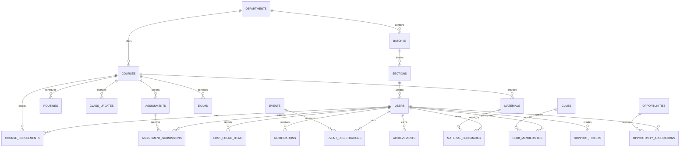

# UniLink — Complete Codebase Audit Report

**Date:** October 26, 2026  
**Auditor:** Antigravity AI  
**Scope:** Read-Only Complete Repository Inspection (`e:/unilink-project/unilink`)  
**Target Stack:** Next.js 15, React 19, TypeScript, Node.js + Express.js REST API, MySQL  

---

## Executive Summary

UniLink has a rich, highly detailed user interface designed for a university ecosystem with dual interfaces for regular students and Class Representatives (CRs). The UI contains design tokens, animations, widgets, and layout scaffolds.

However, the application is currently a **pure client-side UI prototype**. It contains **zero backend integration**, **zero database models**, **zero persistent authentication**, and **hardcoded in-memory state**. Furthermore, a critical Next.js App Router constraint violation currently **breaks production builds** (`npx next build` fails).

---

## 1. Existing Architecture & Folder Structure

### 1.1 Technical Stack & Dependencies

Inspecting [`package.json`](file:///e:/unilink-project/unilink/package.json) reveals:

```json
{
  "name": "unilink",
  "private": true,
  "version": "1.0.0",
  "scripts": {
    "dev": "next dev -H 0.0.0.0",
    "build": "next build",
    "start": "next start",
    "lint": "next lint",
    "format": "oxfmt"
  },
  "dependencies": {
    "next": "15.1.0",
    "react": "^19.0.0",
    "react-dom": "^19.0.0"
  },
  "devDependencies": {
    "@tailwindcss/postcss": "^4.0.0",
    "@types/node": "^22.0.0",
    "@types/react": "^19.0.0",
    "@types/react-dom": "^19.0.0",
    "eslint": "^9.17.0",
    "eslint-config-next": "15.1.0",
    "postcss": "^8.4.49",
    "tailwindcss": "^4.0.0",
    "typescript": "^5.7.0"
  }
}
```

- **Runtime & Framework:** Next.js 15.1.0 with React 19.0.0 and TypeScript 5.7.0.
- **Styling:** Tailwind CSS v4 via `@tailwindcss/postcss` configured in [`postcss.config.mjs`](file:///e:/unilink-project/unilink/postcss.config.mjs) and imported in [`src/app/globals.css`](file:///e:/unilink-project/unilink/src/app/globals.css). However, the vast majority of UI components bypass Tailwind utility classes in favor of inline JavaScript style objects driven by [`src/components/ui/Theme.tsx`](file:///e:/unilink-project/unilink/src/components/ui/Theme.tsx) (`tok(theme)`).
- **Missing Core Libraries:**
  - No backend or server library (`express` is not present).
  - No database ORM or driver (`mysql2`, `prisma`, `drizzle-orm` are absent).
  - No authentication library (`bcrypt`, `jsonwebtoken`, `better-auth`, `next-auth` are absent).
  - No HTTP client (`axios`) or data-fetching utilities (`swr`, `@tanstack/react-query`).
  - No icon library (`lucide-react` is not used; each page duplicates custom inline SVG icon dictionaries).

### 1.2 Architectural Paradigm: SPA-Inside-Next.js

The codebase was migrated from a client-side Single-Page Application (as documented by [`migrate_routes.js`](file:///e:/unilink-project/unilink/migrate_routes.js) and [`refactor_page.js`](file:///e:/unilink-project/unilink/refactor_page.js)). As a result:

1. **Monolithic Dashboard SPA:** [`src/app/dashboard/DashboardView.tsx`](file:///e:/unilink-project/unilink/src/app/dashboard/DashboardView.tsx) (1,140 lines) acts as an entire SPA shell. It imports nearly every page component directly (`RoutinePage`, `AssignmentsPage`, `ExamsPage`, `MaterialsPage`, `AnnouncementsPage`, `EventsPage`, `ClubsPage`, `OpportunitiesPage`, `LostFoundPage`, `NotificationsPage`, `DirectoryPage`, `SettingsPage`, `AchievementsPage`, `ProfilePage`, `HelpPage`) and swaps them in and out using a local state variable `activeNav`.
2. **Monolithic CR Portal SPA:** [`src/app/crportal/CRPortalView.tsx`](file:///e:/unilink-project/unilink/src/app/crportal/CRPortalView.tsx) (3,573 lines) acts as another self-contained SPA for Class Representatives with its own internal tabs (`dashboard`, `routine`, `materials`, `assignments`, `exams`, `classupdates`, `events`, `notifications`).
3. **Parallel Next.js Routes:** Alongside these two giant SPA views, individual route directories exist under `src/app/*` (e.g., `/routine`, `/assignments`, `/exams`). When loaded directly, these pages render without the dashboard sidebar or application navigation shell.

### 1.3 Directory Structure Inventory

```text
e:/unilink-project/unilink/
├── .env.example                      # Template env variables (DATABASE_URL, BETTER_AUTH_*)
├── .figma/                           # Figma plugin cache metadata
├── .gitattributes / .gitignore
├── .mise.toml                        # Toolchain definition (Node 22, pnpm 10.34.3)
├── AGENTS.md                         # Legacy Vite template readme
├── CLAUDE.md
├── fix_imports.js                    # Scratch script used during previous route refactor
├── migrate_routes.js                 # Scratch script used during previous route migration
├── new-file.tsx                      # 0-byte orphan file
├── next-env.d.ts
├── next.config.ts                    # Empty Next.js config
├── package.json
├── pnpm-lock.yaml / pnpm-workspace.yaml
├── postcss.config.mjs
├── refactor_page.js                  # Scratch script used to refactor landing page
├── tsconfig.json
└── src/
    ├── app/                          # Next.js App Router routes & views
    │   ├── achievements/page.tsx
    │   ├── announcements/page.tsx
    │   ├── assignments/
    │   │   ├── page.tsx              # Contains illegal named exports (BREAKS BUILD)
    │   │   └── [id]/page.tsx
    │   ├── clubs/page.tsx
    │   ├── courses/
    │   │   ├── CoursesView.tsx
    │   │   ├── page.tsx
    │   │   └── [id]/page.tsx
    │   ├── cr-portal/page.tsx        # Duplicate route wrapper
    │   ├── crportal/
    │   │   ├── CRPortalView.tsx      # 3,573-line monolithic CR Portal SPA
    │   │   └── page.tsx
    │   ├── dashboard/
    │   │   ├── DashboardView.tsx     # 1,140-line monolithic Student Portal SPA
    │   │   └── page.tsx
    │   ├── directory/page.tsx
    │   ├── events/page.tsx
    │   ├── exams/page.tsx
    │   ├── globals.css               # Global typography, animations & Tailwind v4
    │   ├── help/page.tsx
    │   ├── layout.tsx                # Root layout with ThemeProvider
    │   ├── login/page.tsx            # Mock authentication login
    │   ├── lost-found/page.tsx       # 938-line Lost & Found module
    │   ├── materials/page.tsx
    │   ├── notifications/
    │   │   ├── NotificationsView.tsx
    │   │   └── page.tsx
    │   ├── opportunities/page.tsx
    │   ├── page.tsx                  # 1,060-line Landing page
    │   ├── profile/page.tsx
    │   ├── register/page.tsx         # Mock student registration
    │   ├── routine/page.tsx
    │   └── settings/page.tsx
    ├── auth/                         # Empty directory (no auth logic implemented)
    ├── components/
    │   ├── layout/
    │   │   └── LandingNavbar.tsx     # Landing page fixed navigation
    │   ├── shared/                   # Empty directory
    │   └── ui/
    │       ├── Badge.tsx
    │       ├── Button.tsx            # BtnPrimary & BtnGhost (missing onClick prop)
    │       ├── Card.tsx
    │       ├── Icon.tsx              # Limited icon map (20 icons)
    │       └── Theme.tsx             # ThemeContext, light/dark color tokens
    ├── db/                           # Empty directory (no database models or client)
    ├── hooks/
    │   └── useSR.ts                  # Scroll-reveal intersection observer hook
    ├── imports/
    │   └── pasted_text/              # 35 Markdown specifications & prompt requirements
    ├── lib/                          # Empty directory
    ├── pages/                        # Empty directory (leftover from Pages router)
    └── types/                        # Empty directory
```

---

## 2. Complete Route Inventory

| Route Path | Source File | Status | Notes |
| :--- | :--- | :--- | :--- |
| `/` | [`src/app/page.tsx`](file:///e:/unilink-project/unilink/src/app/page.tsx) | Implemented (UI) | Landing page. Directly embeds [`src/app/lost-found/page.tsx`](file:///e:/unilink-project/unilink/src/app/lost-found/page.tsx) as a section. Hero CTA buttons have no handlers. |
| `/dashboard` | [`src/app/dashboard/page.tsx`](file:///e:/unilink-project/unilink/src/app/dashboard/page.tsx) | Implemented (UI) | Mounts `DashboardView.tsx`. Acts as a master SPA containing tabs for 16 sub-modules. No auth guard. |
| `/login` | [`src/app/login/page.tsx`](file:///e:/unilink-project/unilink/src/app/login/page.tsx) | Partial / Mock | Form with role selector (`student` vs `cr`). Uses `setTimeout(..., 600)` to redirect without checking credentials or creating sessions. |
| `/register` | [`src/app/register/page.tsx`](file:///e:/unilink-project/unilink/src/app/register/page.tsx) | Partial / Mock | Student registration form. Uses `setTimeout(..., 600)` to redirect to `/dashboard`. No persistence or role selection for CRs. |
| `/crportal` | [`src/app/crportal/page.tsx`](file:///e:/unilink-project/unilink/src/app/crportal/page.tsx) | Implemented (UI) | Mounts `CRPortalView.tsx`. Complete CR interface for schedule, assignments, exams, and class updates. No auth guard. |
| `/cr-portal` | [`src/app/cr-portal/page.tsx`](file:///e:/unilink-project/unilink/src/app/cr-portal/page.tsx) | Duplicate Route | Identical wrapper rendering `CRPortalView.tsx`. Navigated to from landing page navbar, whereas login navigates to `/crportal`. |
| `/courses` | [`src/app/courses/page.tsx`](file:///e:/unilink-project/unilink/src/app/courses/page.tsx) | Implemented (UI) | Mounts `CoursesView.tsx`. Course list, filter by semester, syllabus, announcements, materials tabs. In-memory course detail toggle. |
| `/courses/[id]` | [`src/app/courses/[id]/page.tsx`](file:///e:/unilink-project/unilink/src/app/courses/[id]/page.tsx) | Disconnected | Resolves route params and looks up `COURSES`. Never navigated to by `/courses` or `/dashboard`. |
| `/assignments` | [`src/app/assignments/page.tsx`](file:///e:/unilink-project/unilink/src/app/assignments/page.tsx) | **Broken Build** | List, detail, and submission view. Exports `AssignmentDetail` and `ASSIGNMENTS`, breaking Next.js App Router page constraints. |
| `/assignments/[id]` | [`src/app/assignments/[id]/page.tsx`](file:///e:/unilink-project/unilink/src/app/assignments/%5Bid%5D/page.tsx#L4) | Disconnected / Mock | Imports named exports from `../page`. Uses placeholder `alert()` on submit. |
| `/announcements` | [`src/app/announcements/page.tsx`](file:///e:/unilink-project/unilink/src/app/announcements/page.tsx) | Partial (UI) | Categorized announcement feed. Source and Course filter dropdowns have no `onChange` or state bindings. |
| `/routine` | [`src/app/routine/page.tsx`](file:///e:/unilink-project/unilink/src/app/routine/page.tsx) | Implemented (UI) | Weekly class schedule with interactive day/week view, course filter, and class modal. Standalone route lacks layout shell. |
| `/exams` | [`src/app/exams/page.tsx`](file:///e:/unilink-project/unilink/src/app/exams/page.tsx) | Partial (UI) | Exam countdown, exam calendar, syllabus breakdown. "View Campus Location" and "View Course" buttons are dead. |
| `/materials` | [`src/app/materials/page.tsx`](file:///e:/unilink-project/unilink/src/app/materials/page.tsx) | Partial (UI) | Course notes, slides, question papers. Download button on line 530 contains an empty comment `/* download */`. Uses `localStorage` for bookmarks. |
| `/achievements` | [`src/app/achievements/page.tsx`](file:///e:/unilink-project/unilink/src/app/achievements/page.tsx) | Partial (UI) | Gamification, badges, certificate manager, share modal. Add/Edit/Delete mutate in-memory state only. |
| `/events` | [`src/app/events/page.tsx`](file:///e:/unilink-project/unilink/src/app/events/page.tsx) | Partial (UI) | Campus event calendar and registration. Stores registered event IDs in `localStorage` without backend integration. |
| `/clubs` | [`src/app/clubs/page.tsx`](file:///e:/unilink-project/unilink/src/app/clubs/page.tsx) | Partial (UI) | Club directory and membership. Join/leave toggles mutate in-memory state only. |
| `/directory` | [`src/app/directory/page.tsx`](file:///e:/unilink-project/unilink/src/app/directory/page.tsx) | Partial (UI) | Peer directory by department/batch. Connect button modifies local state; "Request Sent · Cancel" button has no handler. |
| `/lost-found` | [`src/app/lost-found/page.tsx`](file:///e:/unilink-project/unilink/src/app/lost-found/page.tsx) | Partial (UI) | Lost and found items, matching modal, report modal. Submissions are stored in component state only. |
| `/opportunities` | [`src/app/opportunities/page.tsx`](file:///e:/unilink-project/unilink/src/app/opportunities/page.tsx) | Partial (UI) | Internships, scholarships, jobs board. "Apply Now" modal fields are not bound to state. |
| `/notifications` | [`src/app/notifications/page.tsx`](file:///e:/unilink-project/unilink/src/app/notifications/page.tsx) | Partial (UI) | Mounts `NotificationsView.tsx`. When accessed directly, notification action buttons fail silently because `onNavigate` is undefined. |
| `/profile` | [`src/app/profile/page.tsx`](file:///e:/unilink-project/unilink/src/app/profile/page.tsx) | Partial (UI) | Student profile editor, bio, skills, portfolio links. Changes reset on browser reload. |
| `/settings` | [`src/app/settings/page.tsx`](file:///e:/unilink-project/unilink/src/app/settings/page.tsx) | Partial (UI) | Preferences and security settings. Password change, sign-out, and delete account buttons only display dummy toasts. |
| `/help` | [`src/app/help/page.tsx`](file:///e:/unilink-project/unilink/src/app/help/page.tsx) | Partial (UI) | FAQ, knowledge base, support ticket submission. Support requests are stored in-memory only. |

---

## 3. Feature-by-Feature Status Breakdown

| Feature | Visual Design | Data Binding | Persistence | Backend API | Verification Status |
| :--- | :---: | :---: | :---: | :---: | :--- |
| **Landing Page** | 100% | Hardcoded | None | None | **Partial** |
| **Authentication (Login/Register)** | 100% | Local State | None | None | **Mock Only** |
| **Student Dashboard** | 100% | Local State | None | None | **Partial** |
| **Courses & Details** | 95% | Local State | None | None | **Partial** |
| **Routine & Schedule** | 95% | Local State | None | None | **Partial** |
| **Announcements** | 90% | Local State | None | None | **Partial** |
| **Assignments & Submission** | 95% | Local State | None | None | **Broken Build / Partial** |
| **Exams & Deadlines** | 90% | Local State | None | None | **Partial** |
| **Class Materials & Notes** | 90% | Local State | `localStorage` (saved IDs) | None | **Partial** |
| **Achievements & Badges** | 95% | Local State | None | None | **Partial** |
| **Events & Calendar** | 95% | Local State | `localStorage` (saved + reg IDs) | None | **Partial** |
| **Clubs & Communities** | 95% | Local State | None | None | **Partial** |
| **Student Directory** | 90% | Local State | None | None | **Partial** |
| **Lost & Found** | 95% | Local State | None | None | **Partial** |
| **Opportunities (Jobs/Internships)** | 90% | Local State | None | None | **Partial** |
| **Notifications Center** | 90% | Local State | None | None | **Partial** |
| **Student Profile** | 90% | Local State | None | None | **Partial** |
| **Settings & Security** | 85% | Local State | None | None | **Partial** |
| **Help & Support Desk** | 90% | Local State | None | None | **Partial** |
| **CR Portal (Class Management)** | 95% | Local State | None | None | **Partial** |

---

## 4. Authentication & Authorization Findings

### 4.1 Missing Next.js Middleware & Route Protection
- There is **no `middleware.ts`** anywhere in the project root or `src/`.
- No session tokens, cookies, or authorization headers are inspected before serving pages.
- Any unauthenticated user can directly access `/dashboard`, `/crportal`, `/cr-portal`, `/settings`, `/profile`, or any sub-route simply by typing the URL in the browser bar.

### 4.2 Login Logic ([`src/app/login/page.tsx`](file:///e:/unilink-project/unilink/src/app/login/page.tsx))
- Lines 18–34: The form submission performs a simple empty check (`if (!email || !password)`).
- Lines 26–33: If valid, it triggers a 600ms artificial `setTimeout` and navigates via `router.push('/dashboard')` or `router.push('/crportal')`.
- No credentials are sent to any API. No JWT, session cookie, or user record is stored.
- Line 109: The "Forgot Password" link uses inline JavaScript to execute:
  `alert("Password reset link sent to your registered email.")`

### 4.3 Registration Logic ([`src/app/register/page.tsx`](file:///e:/unilink-project/unilink/src/app/register/page.tsx))
- Lines 22–34: Checks if required fields are non-empty, triggers a 600ms `setTimeout`, and navigates directly to `/dashboard`.
- No account is created in a database.
- There is no registration option for Class Representatives; registration only accepts student details (Department, Batch, Section).

### 4.4 Role-Based Access Control (RBAC)
- The codebase differentiates between Student and Class Representative (CR) solely via client-side prop toggles:
  - In [`src/app/dashboard/DashboardView.tsx:206`](file:///e:/unilink-project/unilink/src/app/dashboard/DashboardView.tsx#L206): `onCR` determines whether the "CR MANAGEMENT" menu item is visible.
  - In [`src/app/login/page.tsx:28-32`](file:///e:/unilink-project/unilink/src/app/login/page.tsx#L28-L32): Selecting "CR Portal Login" simply redirects to `/crportal`.
  - There are no admin roles, permissions checks, or server-side authorization validations.

### 4.5 Incomplete Auth References
- [`src/.env.example`](file:///e:/unilink-project/unilink/.env.example) contains placeholders for `BETTER_AUTH_SECRET` and `BETTER_AUTH_URL`.
- However, `better-auth` is **not installed** in `package.json`, and [`src/auth/`](file:///e:/unilink-project/unilink/src/auth) is a completely empty directory.

---

## 5. Data Persistence & Mock Data Findings

### 5.1 Zero API Calls & Zero Database Connectivity
- Riipgrep search confirms:
  - `fetch(`: 0 matches in `src/`.
  - `axios`: 0 matches in `src/`.
  - Next.js Route Handlers (`app/**/route.ts`): 0 route files exist.
  - Database clients (`mysql`, `prisma`, `drizzle`): 0 references. [`src/db/`](file:///e:/unilink-project/unilink/src/db) is an empty directory.

### 5.2 Storage Audit
- **`sessionStorage`:** Not used anywhere in the codebase.
- **`localStorage`:** Used in exactly two places:
  1. [`src/app/materials/page.tsx:677,687`](file:///e:/unilink-project/unilink/src/app/materials/page.tsx#L677-L687): Stores a set of bookmarked material IDs under `"unilink_saved_materials"`.
  2. [`src/app/events/page.tsx:1165,1172,1180,1186`](file:///e:/unilink-project/unilink/src/app/events/page.tsx#L1165-L1186): Stores saved and registered event IDs under `"unilink_saved_events"` and `"unilink_reg_events"`.

### 5.3 Hardcoded Data Inventories
Every page embeds static mock arrays directly into source files:
- **Courses:** `COURSES` in [`CoursesView.tsx:64-118`](file:///e:/unilink-project/unilink/src/app/courses/CoursesView.tsx#L64-L118) (5 courses: CSE 305, CSE 307, CSE 301, CSE 310, CSE 303).
- **Routine:** `SCHEDULE` in [`routine/page.tsx:63-128`](file:///e:/unilink-project/unilink/src/app/routine/page.tsx#L63-L128) (15 static timetable slots).
- **Assignments:** `ASSIGNMENTS` in [`assignments/page.tsx:101-164`](file:///e:/unilink-project/unilink/src/app/assignments/page.tsx#L101-L164) (6 hardcoded assignments).
- **Exams:** `EXAMS` in [`exams/page.tsx:62-124`](file:///e:/unilink-project/unilink/src/app/exams/page.tsx#L62-L124) (6 static exams).
- **Announcements:** `INITIAL_ANNOUNCEMENTS` in [`announcements/page.tsx:64-162`](file:///e:/unilink-project/unilink/src/app/announcements/page.tsx#L64-L162) (8 static notices).
- **Clubs:** `CLUBS_DATA` in [`clubs/page.tsx:63-146`](file:///e:/unilink-project/unilink/src/app/clubs/page.tsx#L63-L146) (8 static clubs).
- **Directory:** `ALL_STUDENTS` in [`directory/page.tsx:63-162`](file:///e:/unilink-project/unilink/src/app/directory/page.tsx#L63-L162) (8 static student cards).
- **Lost & Found:** `ITEMS` in [`lost-found/page.tsx:57-118`](file:///e:/unilink-project/unilink/src/app/lost-found/page.tsx#L57-L118) (10 static items).
- **Opportunities:** `OPPORTUNITIES` in [`opportunities/page.tsx:63-148`](file:///e:/unilink-project/unilink/src/app/opportunities/page.tsx#L63-L148) (8 static job/internship listings).
- **Notifications:** `INITIAL_NOTIFS` in [`NotificationsView.tsx:64-177`](file:///e:/unilink-project/unilink/src/app/notifications/NotificationsView.tsx#L64-L177) (13 static notifications).

---

## 6. Dead Buttons, Broken Links & Interaction Problems

The following interactive elements are verified to be broken, inert, missing event handlers, or using fake interactions:

### 6.1 Landing Page & Navigation
1. **[`src/components/ui/Button.tsx:6,10`](file:///e:/unilink-project/unilink/src/components/ui/Button.tsx#L6-L10):**
   `BtnPrimary` and `BtnGhost` component definitions do **not accept an `onClick` prop**. Any `onClick` passed to them is discarded by React TypeScript typing or ignored.
2. **[`src/app/page.tsx:129-130`](file:///e:/unilink-project/unilink/src/app/page.tsx#L129-L130):**
   Hero CTA buttons `<BtnPrimary large t={theme}>Get Started</BtnPrimary>` and `<BtnGhost large t={theme}>Explore UniLink</BtnGhost>` have no `onClick` handlers and do nothing.
3. **[`src/app/page.tsx:1013-1018`](file:///e:/unilink-project/unilink/src/app/page.tsx#L1013-L1018):**
   All 16 footer navigation links are rendered as `<a>{l}</a>` without `href` attributes, rendering them non-functional.
4. **[`src/app/page.tsx:1000-1004`](file:///e:/unilink-project/unilink/src/app/page.tsx#L1000-L1004):**
   Social media footer icons (Twitter, GitHub, LinkedIn) are wrapped in `<div>` tags with no links.
5. **[`src/app/page.tsx:1040,1055`](file:///e:/unilink-project/unilink/src/app/page.tsx#L1040-L1055):**
   Landing page uses `window.location.href = "/dashboard"` triggering full browser reloads instead of client-side Next.js routing.

### 6.2 Assignments Module
6. **[`src/app/assignments/page.tsx:537-539`](file:///e:/unilink-project/unilink/src/app/assignments/page.tsx#L537-L539):**
   "View Course" button in assignment details has no `onClick` handler.
7. **[`src/app/assignments/page.tsx:571`](file:///e:/unilink-project/unilink/src/app/assignments/page.tsx#L571):**
   "View" button in submission history list has no `onClick` handler.
8. **[`src/app/assignments/[id]/page.tsx:17`](file:///e:/unilink-project/unilink/src/app/assignments/%5Bid%5D/page.tsx#L17):**
   `onSubmit` triggers an alert (`alert("Submission modal for " + assignment.title + " opened.")`) rather than opening a submission modal or route.

### 6.3 Announcements Module
9. **[`src/app/announcements/page.tsx:623-630`](file:///e:/unilink-project/unilink/src/app/announcements/page.tsx#L623-L630):**
   The "All Sources" and "All Courses" `<select>` elements have no `value` or `onChange` attributes; selecting an option does nothing.

### 6.4 Exams Module
10. **[`src/app/exams/page.tsx:732-734`](file:///e:/unilink-project/unilink/src/app/exams/page.tsx#L732-L734):**
    "View Campus Location" button has no `onClick` handler.
11. **[`src/app/exams/page.tsx:749-751`](file:///e:/unilink-project/unilink/src/app/exams/page.tsx#L749-L751):**
    "View Course" button has no `onClick` handler.

### 6.5 Materials Module
12. **[`src/app/materials/page.tsx:530`](file:///e:/unilink-project/unilink/src/app/materials/page.tsx#L530):**
    The download button contains an empty handler: `onClick={() => { /* download */ }}`.

### 6.6 Directory Module
13. **[`src/app/directory/page.tsx:423`](file:///e:/unilink-project/unilink/src/app/directory/page.tsx#L423):**
    The "Request Sent · Cancel" button on a student card has no `onClick` handler.

### 6.7 Opportunities Module
14. **[`src/app/opportunities/page.tsx:292-329`](file:///e:/unilink-project/unilink/src/app/opportunities/page.tsx#L292-L329):**
    All inputs inside the "Apply Now" modal (Full Name, Email, Phone, Department, Batch, Cover Letter, Portfolio) have no `value` or `onChange` bindings; clicking "Submit Application" advances to a success view without recording any entered data.

### 6.8 Notifications Module
15. **[`src/app/notifications/NotificationsView.tsx:385`](file:///e:/unilink-project/unilink/src/app/notifications/NotificationsView.tsx#L385):**
    Notification action buttons call `onNavigate?.(notif.action!.target)`. When visiting `/notifications` directly, `onNavigate` is `undefined`, causing action clicks to fail silently without navigating anywhere.

### 6.9 Settings Module
16. **[`src/app/settings/page.tsx:581`](file:///e:/unilink-project/unilink/src/app/settings/page.tsx#L581):**
    "Update Password" button does not validate password fields and displays a fake success toast without updating anything.
17. **[`src/app/settings/page.tsx:615,620,644`](file:///e:/unilink-project/unilink/src/app/settings/page.tsx#L615-L644):**
    "Sign Out" and "Sign Out All Devices" buttons only trigger toasts without clearing state or destroying sessions.
18. **[`src/app/settings/page.tsx:882,893,912`](file:///e:/unilink-project/unilink/src/app/settings/page.tsx#L882-L912):**
    "Connect Google/Microsoft", "Deactivate Account", and "Delete Account Permanently" buttons only fire temporary toast messages.

### 6.10 CR Portal (Class Representative Modals)
19. **[`src/app/crportal/CRPortalView.tsx:356`](file:///e:/unilink-project/unilink/src/app/crportal/CRPortalView.tsx#L356):**
    `UploadMaterialModal`: "Upload & Publish" button simply executes `onClick={onClose}`.
20. **[`src/app/crportal/CRPortalView.tsx:391-392`](file:///e:/unilink-project/unilink/src/app/crportal/CRPortalView.tsx#L391-L392):**
    `CreateAssignmentModal`: Both "Save Draft" and "Publish Assignment" buttons execute `onClick={onClose}`.
21. **[`src/app/crportal/CRPortalView.tsx:430-431`](file:///e:/unilink-project/unilink/src/app/crportal/CRPortalView.tsx#L430-L431):**
    `CreateAnnouncementModal`: Both "Save Draft" and "Publish Now" execute `onClick={onClose}`.
22. **[`src/app/crportal/CRPortalView.tsx:513-514`](file:///e:/unilink-project/unilink/src/app/crportal/CRPortalView.tsx#L513-L514):**
    `AddExamModal`: Both "Save Draft" and "Publish Exam" execute `onClick={onClose}`.
23. **[`src/app/crportal/CRPortalView.tsx:533-534`](file:///e:/unilink-project/unilink/src/app/crportal/CRPortalView.tsx#L533-L534):**
    `CreateEventModal`: Both "Save Draft" and "Publish Event" execute `onClick={onClose}`.
24. **[`src/app/crportal/CRPortalView.tsx:670`](file:///e:/unilink-project/unilink/src/app/crportal/CRPortalView.tsx#L670):**
    `PostClassUpdateModal`: Clicking "Post Update" toggles `setDone(true)` without appending the update to any state array.
25. **[`src/app/crportal/CRPortalView.tsx:2024-2029`](file:///e:/unilink-project/unilink/src/app/crportal/CRPortalView.tsx#L2024-L2029):**
    `CRClassUpdatesPage` declares `const updates = [...]` as a local immutable array rather than React state (`useState`), making it impossible to add, edit, or remove updates dynamically.

---

## 7. Build and Type-Check Results

### 7.1 TypeScript Type-Check (`npx tsc --noEmit`)
- **Status:** PASSED (Exit Code: 0).
- **Result:** TypeScript syntax and static typings in isolated files pass cleanly.

### 7.2 Production Build (`npx next build`)
- **Status:** **FAILED (Exit Code: 1)**.
- **Confirmed Error Trace:**
  ```text
     ▲ Next.js 15.1.0

     Creating an optimized production build ...
   ✓ Compiled successfully
     Linting and checking validity of types ...
  Failed to compile.

  .next/types/app/assignments/page.ts:12:13
  Type error: Type 'OmitWithTag<typeof import("E:/unilink-project/unilink/src/app/assignments/page"), "default" | "config" | "generateStaticParams" | "revalidate" | "dynamic" | "dynamicParams" | "fetchCache" | ... 7 more ... | "experimental_ppr", "">' does not satisfy the constraint '{ [x: string]: never; }'.
    Property 'AssignmentDetail' is incompatible with index signature.
      Type '({ assignment: a, onBack, onSubmit }: { assignment: Assignment; onBack: () => void; onSubmit: () => void; }) => Element' is not assignable to type 'never'.

    10 |
    11 | // Check that the entry is a valid entry
  > 12 | checkFields<Diff<{
       |             ^
    13 |   default: Function
    14 |   config?: {}
    15 |   generateStaticParams?: Function
  ```

#### Root Cause Analysis
In Next.js App Router, page modules (`src/app/**/page.tsx`) **must only export a default React component** and reserved route segment configuration options (such as `generateStaticParams`, `revalidate`, `dynamic`).
In [`src/app/assignments/page.tsx`](file:///e:/unilink-project/unilink/src/app/assignments/page.tsx):
- Line 101 exports `export const ASSIGNMENTS: Assignment[] = [...]`.
- Line 361 exports `export function AssignmentDetail(...)`.
These named exports violate Next.js App Router conventions and cause Next.js type generation to fail the build. Furthermore, [`src/app/assignments/[id]/page.tsx:4`](file:///e:/unilink-project/unilink/src/app/assignments/%5Bid%5D/page.tsx#L4) directly imports these invalid exports (`import { AssignmentDetail, ASSIGNMENTS } from "../page"`).

### 7.3 ESLint Check (`npm run lint`)
- **Status:** FAILED (Exit Code: 1).
- **Result:** Fails because no `.eslintrc.json` or `eslint.config.mjs` exists in the repository root. When run non-interactively, Next.js lint pauses and errors out because it prompts the user to select an ESLint configuration.

---

## 8. Missing Backend and MySQL Requirements

The target architecture requires a dedicated Node.js + Express.js REST API with a MySQL database. Currently, **0% of the backend is implemented**.

### 8.1 Required Backend Infrastructure
1. **Server Architecture:**
   - Dedicated Express server entrypoint (`server.ts` or `backend/src/server.ts`).
   - CORS, Helmet security headers, cookie-parser, and JSON body parsing middleware.
   - Centralized error handling and async request wrapper.
2. **Database Connectivity:**
   - MySQL database connection pool using `mysql2/promise` or an ORM like Drizzle / Prisma.
   - Migration management tooling to track database schema evolution.
3. **Authentication & Session Security:**
   - Password hashing via `bcrypt` (minimum 10 salt rounds).
   - Secure HTTP-only cookie session handling with signed JWTs or session tokens.
   - Role-based middleware (`requireAuth`, `requireRole('cr')`, `requireRole('admin')`).
4. **File Storage & Uploads:**
   - Multipart file upload handling (via `multer`) for lecture notes, assignment attachments, student submissions, and profile pictures.
   - Secure static storage or S3-compatible object storage.

---

## 9. Recommended Database Entities & Relationships

To support all features currently present in the UI, the following normalized relational schema is recommended for MySQL:



### Table Specifications

1. **`departments`**: `id` (PK, UUID/INT), `code` (VARCHAR(10)), `name` (VARCHAR(100)), `created_at`.
2. **`batches`**: `id` (PK), `department_id` (FK), `batch_number` (VARCHAR(20)), `year` (INT).
3. **`sections`**: `id` (PK), `batch_id` (FK), `section_name` (VARCHAR(10)), `cr_user_id` (FK to users).
4. **`users`**:
   - `id` (PK, UUID), `student_id` (VARCHAR(30), UNIQUE), `email` (VARCHAR(120), UNIQUE), `password_hash` (VARCHAR(255)).
   - `full_name` (VARCHAR(100)), `role` (ENUM: `'student'`, `'cr'`, `'faculty'`, `'admin'`).
   - `department_id` (FK), `batch_id` (FK), `section_id` (FK).
   - `avatar_url` (VARCHAR(255)), `bio` (TEXT), `phone` (VARCHAR(20)), `github_url`, `linkedin_url`, `portfolio_url`.
   - `is_verified` (BOOLEAN), `created_at`, `updated_at`.
5. **`courses`**:
   - `id` (PK, UUID), `code` (VARCHAR(20)), `name` (VARCHAR(100)), `department_id` (FK), `credits` (DECIMAL(3,1)), `semester` (VARCHAR(20)), `color` (VARCHAR(20)).
6. **`course_enrollments`**: `id` (PK), `user_id` (FK), `course_id` (FK), `section_id` (FK), `enrolled_at`.
7. **`routines`** (Class Schedule):
   - `id` (PK), `course_id` (FK), `section_id` (FK), `day_of_week` (ENUM: `'Sunday'`..`'Saturday'`), `start_time` (TIME), `end_time` (TIME), `room` (VARCHAR(30)), `instructor_name` (VARCHAR(100)).
8. **`class_updates`** (CR Posts):
   - `id` (PK), `course_id` (FK), `section_id` (FK), `cr_user_id` (FK), `update_type` (ENUM: `'Class Delayed'`, `'Class Cancelled'`, `'Room Changed'`, `'Extra Class'`, `'Schedule Changed'`, `'General'`), `previous_info` (VARCHAR(100)), `new_info` (VARCHAR(100)), `note` (TEXT), `created_at`.
9. **`announcements`**:
   - `id` (PK), `title` (VARCHAR(200)), `body` (TEXT), `category` (VARCHAR(50)), `priority` (ENUM: `'Normal'`, `'Important'`, `'Urgent'`), `source` (VARCHAR(50)), `section_id` (FK, NULLable for department/all), `department_id` (FK, NULLable), `author_id` (FK), `created_at`.
10. **`assignments`**:
    - `id` (PK), `course_id` (FK), `section_id` (FK), `created_by` (FK), `title` (VARCHAR(200)), `description` (TEXT), `issue_date` (DATETIME), `due_date` (DATETIME), `total_marks` (INT), `max_attempts` (INT), `attachment_url` (VARCHAR(255)), `created_at`.
11. **`assignment_submissions`**:
    - `id` (PK), `assignment_id` (FK), `student_id` (FK), `attempt_number` (INT), `file_url` (VARCHAR(255)), `student_note` (TEXT), `status` (ENUM: `'submitted'`, `'graded'`, `'late'`), `marks_obtained` (DECIMAL(5,2)), `feedback` (TEXT), `submitted_at`.
12. **`exams`**:
    - `id` (PK), `course_id` (FK), `section_id` (FK), `title` (VARCHAR(100)), `exam_type` (ENUM: `'midterm'`, `'final'`, `'quiz'`, `'lab'`), `exam_date` (DATE), `start_time` (TIME), `duration_minutes` (INT), `room` (VARCHAR(30)), `building` (VARCHAR(50)), `syllabus` (JSON), `status` (VARCHAR(30)).
13. **`materials`**:
    - `id` (PK), `course_id` (FK), `section_id` (FK), `uploader_id` (FK), `title` (VARCHAR(200)), `description` (TEXT), `category` (ENUM: `'Lecture'`, `'Slides'`, `'Notes'`, `'Lab'`, `'Question Paper'`), `file_ext` (VARCHAR(10)), `file_size` (VARCHAR(20)), `file_url` (VARCHAR(255)), `is_archived` (BOOLEAN), `created_at`.
14. **`material_bookmarks`**: `id` (PK), `user_id` (FK), `material_id` (FK), `created_at`.
15. **`events`**:
    - `id` (PK), `title` (VARCHAR(200)), `category` (VARCHAR(50)), `organizer_name` (VARCHAR(100)), `organizer_type` (VARCHAR(50)), `event_date` (DATE), `start_time` (TIME), `location` (VARCHAR(100)), `capacity` (INT), `description` (TEXT), `registration_deadline` (DATETIME), `created_at`.
16. **`event_registrations`**: `id` (PK), `event_id` (FK), `user_id` (FK), `registered_at`.
17. **`clubs`**:
    - `id` (PK), `name` (VARCHAR(100)), `tagline` (VARCHAR(200)), `category` (VARCHAR(50)), `department_id` (FK), `description` (TEXT), `join_type` (VARCHAR(30)), `emoji` (VARCHAR(10)), `meeting_day` (VARCHAR(20)), `meeting_time` (VARCHAR(30)), `meeting_location` (VARCHAR(100)).
18. **`club_memberships`**: `id` (PK), `club_id` (FK), `user_id` (FK), `role` (VARCHAR(30)), `status` (ENUM: `'pending'`, `'member'`, `'left'`), `joined_at`.
19. **`opportunities`**:
    - `id` (PK), `title` (VARCHAR(200)), `type` (VARCHAR(50)), `organization` (VARCHAR(100)), `location` (VARCHAR(100)), `remote` (BOOLEAN), `deadline` (DATE), `eligibility` (TEXT), `description` (TEXT), `created_at`.
20. **`opportunity_applications`**: `id` (PK), `opportunity_id` (FK), `user_id` (FK), `resume_url` (VARCHAR(255)), `cover_letter` (TEXT), `status` (VARCHAR(30)), `applied_at`.
21. **`lost_found_items`**:
    - `id` (PK), `user_id` (FK), `kind` (ENUM: `'lost'`, `'found'`), `title` (VARCHAR(150)), `category` (VARCHAR(50)), `location` (VARCHAR(150)), `incident_date` (DATE), `description` (TEXT), `status` (ENUM: `'Searching'`, `'Looking for Owner'`, `'Possible Match'`, `'Returned'`), `image_url` (VARCHAR(255)), `created_at`.
22. **`notifications`**:
    - `id` (PK), `user_id` (FK), `category` (VARCHAR(30)), `priority` (VARCHAR(20)), `title` (VARCHAR(200)), `body` (TEXT), `action_label` (VARCHAR(50)), `action_target` (VARCHAR(100)), `is_read` (BOOLEAN DEFAULT FALSE), `created_at`.
23. **`achievements`**:
    - `id` (PK), `user_id` (FK), `title` (VARCHAR(150)), `category` (VARCHAR(50)), `issuer` (VARCHAR(100)), `issue_date` (DATE), `description` (TEXT), `evidence_url` (VARCHAR(255)), `verification_status` (ENUM: `'verified'`, `'pending'`, `'unverified'`), `created_at`.
24. **`support_tickets`**:
    - `id` (PK), `user_id` (FK), `ticket_type` (ENUM: `'support'`, `'report'`), `subject` (VARCHAR(200)), `category` (VARCHAR(50)), `message` (TEXT), `status` (ENUM: `'open'`, `'in_progress'`, `'resolved'`, `'closed'`), `created_at`, `updated_at`.

---

## 10. Prioritized Implementation Roadmap

### Phase 1: Codebase Stabilization & Next.js Build Fixes (Immediate)
1. **Fix `next build` Compilation Failure:** Extract `ASSIGNMENTS` mock array and `AssignmentDetail` component out of [`src/app/assignments/page.tsx`](file:///e:/unilink-project/unilink/src/app/assignments/page.tsx) into a shared view component or data helper (`src/app/assignments/AssignmentsView.tsx`), ensuring `page.tsx` only exports the default page component.
2. **Resolve Route Redundancy:** Consolidate `/crportal` and `/cr-portal` into a single canonical route (`/cr-portal` or `/crportal`) with a permanent 301 redirect for the duplicate.
3. **Configure ESLint:** Add `.eslintrc.json` or `eslint.config.mjs` to ensure `npm run lint` executes non-interactively without prompting or failing.
4. **Repair UI Component Primitives:** Update [`src/components/ui/Button.tsx`](file:///e:/unilink-project/unilink/src/components/ui/Button.tsx) so `BtnPrimary` and `BtnGhost` support `onClick` and `type` attributes. Wire up the landing page hero CTA buttons.

### Phase 2: Backend Architecture & MySQL Database Setup
1. **Express.js API Scaffold:** Create a modular Express server backend (e.g. `server/`) with TypeScript, routing controllers, CORS, and request logging.
2. **MySQL Connection Pool & Migrations:** Set up database schema migrations for the core relational tables (`users`, `departments`, `batches`, `sections`, `courses`, `course_enrollments`).
3. **API Client & Data Fetching:** Establish a standardized API fetch client in Next.js (`src/lib/api.ts`) with typed endpoints and token handling.

### Phase 3: Authentication, Authorization & Route Guards
1. **Registration & Password Hashing:** Implement real registration in Express with `bcrypt` password hashing and unique student ID verification.
2. **JWT / Session Cookie Management:** Implement login endpoints returning HTTP-only, Secure JWT authentication cookies.
3. **Next.js Auth Middleware:** Add `src/middleware.ts` to protect `/dashboard`, `/crportal`, `/settings`, and other student routes, redirecting unauthenticated users to `/login`.
4. **Role Enforcement:** Restrict CR Portal endpoints and UI routes to authenticated users with `role = 'cr'`.

### Phase 4: Academic Core (Routine, Courses, Class Updates, Announcements)
1. **Routine & Timetable API:** Implement CRUD endpoints for section schedules.
2. **Class Updates (CR):** Connect CR "Post Class Update" modal to save updates to MySQL and display them live on both CR and student dashboards.
3. **Announcements Feed:** Connect announcement creation and section targeting to database records. Wire up the missing source/course filter dropdowns.
4. **Course Details & Dynamic Routing:** Link `/courses` cards to `/courses/[id]` dynamic pages populated with real database records.

### Phase 5: Assignments & Study Materials Workflow
1. **Assignment Management:** Enable CRs/Faculty to create assignments with issue/due dates and attachments.
2. **Student Submission Pipeline:** Implement multipart file upload for student submissions, recording timestamp, attempt count, and submission ID in MySQL.
3. **Class Materials:** Connect material upload and download endpoints; replace the empty `/* download */` button handler with actual file downloads.

### Phase 6: Campus Life Modules
1. **Events & Registrations:** Store events in MySQL; replace `localStorage` with real registration records and capacity tracking.
2. **Clubs & Memberships:** Store club directories and applications in database; persist student membership statuses.
3. **Student Directory & Connections:** Enable student profile directory search and mutual networking connection requests.
4. **Lost & Found:** Store reported items and matches in MySQL.
5. **Opportunities:** Store jobs and internships; wire up application modal inputs to record student applications.

### Phase 7: User Settings, Notifications & Help Desk
1. **Notification Delivery:** Trigger notifications automatically when class updates, new assignments, or announcements are posted.
2. **Profile & Preferences:** Save student bio, skills, links, and avatar changes to the database.
3. **Settings Persistence:** Implement real password changes, session invalidation, and account deactivation.
4. **Help Desk Tickets:** Store user inquiries and bug reports in MySQL.
